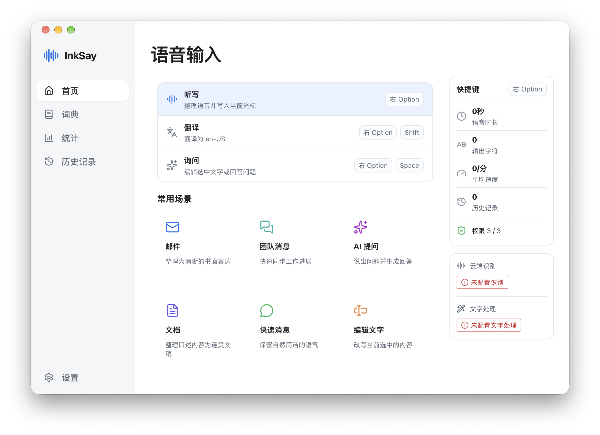

<p align="center"></p>

# InkSay

支持自配模型的桌面语音输入工具。按住快捷键口述，识别后的文字可写入当前应用。

InkSay 支持云端识别、本地 Whisper，以及可选的文字整理、翻译和语音询问。API Key 由使用者自行配置，录音、词典和历史记录保存在本机。



macOS 首页。截图来自独立源码构建，尚未配置识别与文字处理服务。

## 功能

- **语音输入**：按住录音、松开处理，也可在设置中切换为单击启停。
- **识别方式**：云端支持文件上传、音频消息和 DashScope 同步接口；本地支持 Whisper。
- **文字处理**：可接入 OpenAI 兼容文字模型，进行整理、翻译或对选中文字提问。听写未配置文字模型时直接使用识别结果。
- **词典与纠错**：专有词、确定性替换规则、纠错建议；中英文间距、中文与数字间距、中文标点默认保持原样。
- **历史与统计**：查看原始识别、整理结果及各阶段信息，保留录音以便排查；查看使用趋势与活跃情况。
- **长录音**：支持的百炼 DashScope 模型自动对超限音频进行 FLAC 无损压缩和分段识别，最后合并文字再整理。

## 平台状态

| 平台 | 当前状态 |
| --- | --- |
| macOS / Apple Silicon | 主要验证平台；录音、浮窗和文字写入已进行本机使用验证 |
| Windows / x64 | 开发预览；已进行编译检查及部分 Windows 11 虚拟机测试，仍需更多实体设备反馈 |
| macOS / Intel、Windows / ARM64、Linux | 本次发布未完成验收或不提供原生支持 |

最低系统版本兼容性矩阵尚未完成，不将当前开发机的结果视为所有设备均通过。

## 安装与使用

首个公开 Release 尚未发布。当前可以按[开发指南](docs/DEVELOPMENT.md)从源码构建；公开发布后，安装包与校验信息将放在仓库 Releases 中。

1. 启动应用，按系统提示授予需要的权限。macOS 需要麦克风、辅助功能和输入监控权限。
2. 在设置中配置云端识别的服务地址、模型及 API Key，保存并测试连接。也可以选择本地 Whisper 并下载模型。
3. 需要文字整理时，另行配置文字模型。它与语音识别使用独立的密钥和请求地址。
4. 在目标应用输入框中按住快捷键，说完松开。输入焦点切换或目标应用拒绝写入时，可在历史记录中复制结果。

默认听写快捷键为 macOS **右 Option**、Windows **右 Ctrl**。与 **Shift** 组合为翻译，与 **Space** 组合为询问；可以在设置中调整。

百炼初始配置为 `qwen-audio-3.1-asr-flash` / DashScope。不同协议需要不同的地址和模型，具体示例见[模型配置指南](docs/CONFIGURATION.md)。

本次开源范围为 macOS 和 Windows 桌面端；iOS 暂不公开。

## 数据与隐私

- 没有 InkSay 账号系统，不需要连接开发者运营的识别后端。
- 使用云端识别时，音频和用于识别的词典信息会发送到你配置的服务；文字整理、翻译或询问会向文字模型发送对应文字和可用的输入场景上下文。
- 本地 Whisper 在本机识别。首次下载模型和构建依赖仍需要网络；开启云端文字处理时，文字仍会发送到对应服务。
- API Key 存在系统凭据存储中，不保存在配置 JSON。应用不主动将本地历史、录音或日志上传给开发者。

详细说明见[隐私与网络行为](docs/PRIVACY.md)、[数据存储与恢复](docs/DATA.md)。提交问题时请先删除日志和截图中的个人信息。

## 开发与贡献

```sh
git clone https://github.com/supersoloer/inksay.git
cd inksay
npm ci
npm run tauri dev
```

需要 Node.js 22+、Rust、Git 和 CMake；Windows 还需要 MSVC 构建工具与 WebView2。完整的环境准备、测试、打包和缓存清理见[开发指南](docs/DEVELOPMENT.md)。

欢迎提交问题和改进。请阅读 [CONTRIBUTING.md](CONTRIBUTING.md)。安全问题请按 [SECURITY.md](SECURITY.md) 私下反馈，避免在公开 Issue 中附带密钥、录音或个人文字。

## 许可证

本仓库公开的 InkSay 桌面源码采用 **GPL-3.0-only**，详见 [LICENSE](LICENSE)。可以使用、修改和商业分发；分发受许可证覆盖的修改版或二进制时，需要遵守对应源码提供及许可通知要求。

第三方组件、模型和示例音频保留各自条款，见 [THIRD_PARTY_NOTICES.md](THIRD_PARTY_NOTICES.md)。使用其他模型服务时，还需遵守服务提供者的条款。衍生项目请明确自己的维护者和发行来源，避免被误认为 InkSay 官方版本。

## 开发者

公众号：**@唐小羲** · 小红书：[**@唐小羲**](https://www.xiaohongshu.com/user/profile/5df9060d0000000001004d95) · 邮箱：[imseantang@gmail.com](mailto:imseantang@gmail.com)
